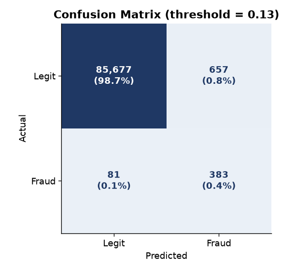

# Fraud Detection on Payment Transactions

[](https://github.com/Ehsan-Ghoreishi/fraud-detection/actions/workflows/ci.yml)


An end-to-end machine-learning pipeline that flags fraudulent card
transactions, built the way a **fraud / risk analyst** would actually approach
it: domain-driven features, honest evaluation for imbalanced data, and a
**business-cost-based decision threshold** rather than a default 0.5.

> Built by **Seyedmohammad (Ehsan) Ghoreishi** — a data professional focused on
> risk, fraud, and financial analytics. This project demonstrates the exact
> skills used in Customer Risk / Anti-Financial-Crime (AFC) analytics roles at
> fintechs and banks.

---

## Why this project

Most beginner fraud projects report "99% accuracy" and stop there. On data
where fraud is ~1.7% of transactions, **a model that never predicts fraud is
already 98.3% accurate — and completely useless.** The interesting problem in
fraud is the trade-off between *catching fraud* and *not annoying real
customers*, and choosing where to draw that line based on cost.

This project is built around that reality.

---

## Headline results

On a held-out test set (25% of data) that played **no part** in feature
statistics, model selection or threshold tuning:

| Metric | Value | What it means |
|---|---|---|
| **Fraud caught (recall)** | **97.6%** | Of all real fraud, we catch nearly all of it |
| **Precision** | 84.1% | Of everything we flag, ~5 in 6 are truly fraud |
| **PR-AUC** | 0.990 | Ranking quality on the imbalanced positive class |
| **ROC-AUC** | 0.9998 | Overall separability |
| **Traffic flagged** | 2.0% | Only a small slice needs review |
| **False alarms per real fraud** | 0.2 | Very low customer friction |

Concretely, on 15,000 test transactions the model missed **6 frauds out of
255** while flagging just 47 legitimate transactions for review.


---

## The idea that makes it a *risk* project, not just a *model*

A missed fraud and a false alarm do **not** cost the same. Letting fraud
through costs real money (chargebacks, losses); a false alarm just costs a
quick review. I encode that asymmetry directly and pick the decision threshold
that **minimises expected business cost** instead of accepting the default:

```
Cost = (false negatives × €150) + (false positives × €5)
```

The threshold is tuned on **out-of-fold predictions from the training set**
and then frozen — exactly as it would be before going live — and only then
measured on the test set:


The cost-optimal threshold lands at **0.77**. An honest finding from the
held-out data: the cost curve is almost flat between ~0.5 and ~0.8, and on
this particular test sample the tuned threshold (€1,135) is no better than
the default 0.5 (€1,005). With only ~250 frauds in the test set, a couple of
extra misses swing the total. The lesson for a risk team is that the
*cost assumptions* move the threshold far more than fine-tuning does — and
the pipeline re-runs that analysis in one command:

```bash
fraud-detection train --cost-fn 400 --cost-fp 5   # e.g. higher-value card portfolio
```

> An earlier version of this project tuned the threshold and picked the
> model on the test set itself, which reported 0.65 / 98.8% recall. See
> [CHANGELOG.md](CHANGELOG.md) for what changed and why.

---

## Understanding the data first (EDA)

Before modelling, I looked at *how* fraud actually behaves. The signal is
strong and intuitive — fraud skews toward nights, new devices, foreign
countries, higher amounts, and velocity spikes:


| Signal | Legit | Fraud |
|---|---|---|
| Median amount | €20 | €70 |
| Night transactions (00–05h) | 3.2% | 41.6% |
| New device | 5.0% | 53.6% |
| Foreign country | 7.9% | 43.8% |

---

## What the model relies on (explainability)

In a regulated bank you must be able to **justify why a customer was flagged**.
I use permutation importance (works for any model, measures real predictive
contribution) rather than opaque built-in scores:


Importance is the drop in PR-AUC when a feature is shuffled on the test set.
Merchant risk and distance-from-home dominate — consistent with how real card
fraud presents.



---

## Engineering choices worth calling out

- **Stratified train/test split** so both sets keep the true fraud ratio.
- **No data leakage** — every learned statistic (feature cut-offs, scaling)
  lives inside an sklearn `Pipeline`, and the model choice and decision
  threshold come from 5-fold cross-validation on the training split. The
  test set is scored exactly once.
- **Imbalance handled with `class_weight="balanced"`**, not naive oversampling
  that would leak synthetic rows into evaluation.
- **Two models compared** (logistic regression vs random forest) and selected
  by out-of-fold **PR-AUC**, the correct metric for rare-event detection.
- **Deployable artefact** — the fitted pipeline is saved together with its
  threshold, and `fraud-detection score` applies it to new transactions.
- **Tested and reproducible** — fixed seeds, a pytest suite and CI on
  Python 3.10–3.12; one command regenerates every number and figure.

---

## Project structure

```
fraud-detection/
├── src/fraud_detection/
│   ├── config.py        # paths, seed, cost assumptions
│   ├── data.py          # realistic synthetic transactions (real fraud patterns)
│   ├── features.py      # domain features + leakage-safe FraudFeatures transformer
│   ├── models.py        # candidate pipelines
│   ├── evaluation.py    # cost curve and threshold selection
│   ├── model.py         # CV model selection, threshold tuning, test evaluation
│   ├── scoring.py       # save/load model bundle, score new transactions
│   ├── eda.py           # exploratory analysis + overview figure
│   ├── plots.py         # reporting figures
│   └── cli.py           # `fraud-detection` command
├── tests/               # pytest suite
├── notebooks/           # step-by-step walkthrough
├── reports/             # generated metrics.json + figures
├── docs/model_card.md   # intended use, limitations, evaluation
├── Makefile
└── pyproject.toml
```

> **Note on data:** real payment data is confidential, so this repo generates a
> synthetic dataset that reproduces the statistical patterns of genuine card
> fraud (imbalance, night-time skew, velocity, geography). The modelling
> pipeline is identical to what you'd run on real data — only the source
> changes.

---

## Run it yourself

```bash
pip install -e ".[dev]"

make all        # generate data, EDA, train, evaluate, save model + figures
make test       # run the test suite
```

Or step by step with the CLI:

```bash
fraud-detection generate                 # data/transactions.csv
fraud-detection eda                      # reports/eda_overview.png
fraud-detection train                    # metrics.json, figures, models/fraud_model.joblib
fraud-detection score new.csv -o scored.csv   # adds fraud_probability + flag
```

Everything is seeded, so the numbers above reproduce exactly with the
dependency versions in `requirements.txt`.

---

## Tech stack

`Python` · `pandas` · `NumPy` · `scikit-learn` · `Matplotlib` · `pytest` · `ruff` · `GitHub Actions`

## Skills demonstrated

Imbalanced classification · feature engineering · cost-sensitive decision
thresholds · model evaluation (PR-AUC, precision/recall, confusion matrix) ·
explainability (permutation importance) · leakage-free pipelines ·
cross-validated model selection · tested, packaged, CI-checked code ·
reproducible, documented work — the core toolkit for **fraud, risk, and
financial-crime analytics**.
