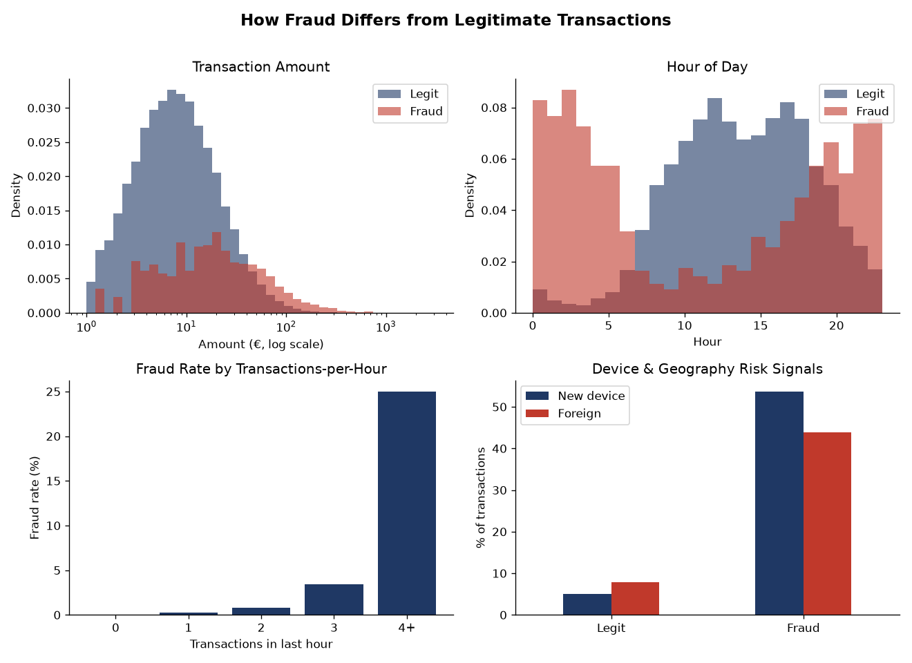
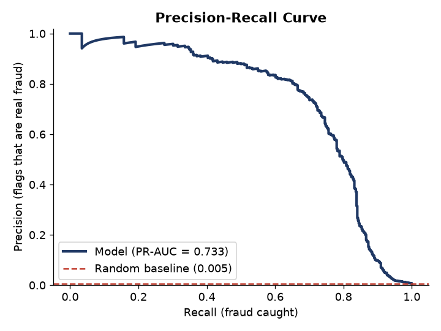
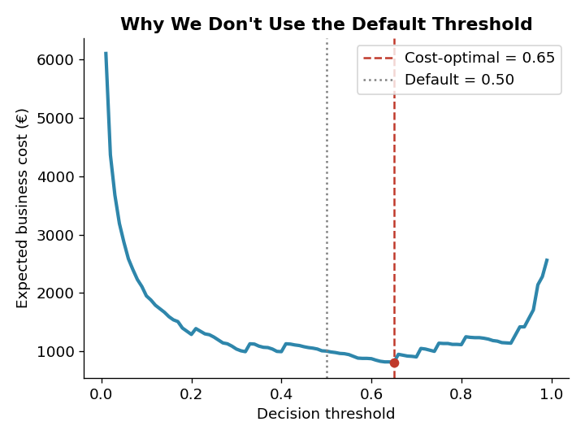
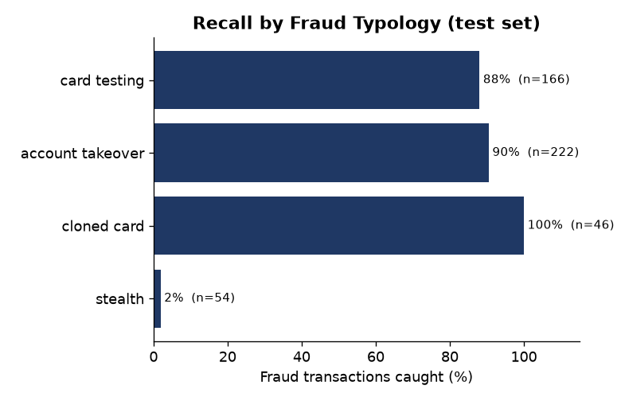
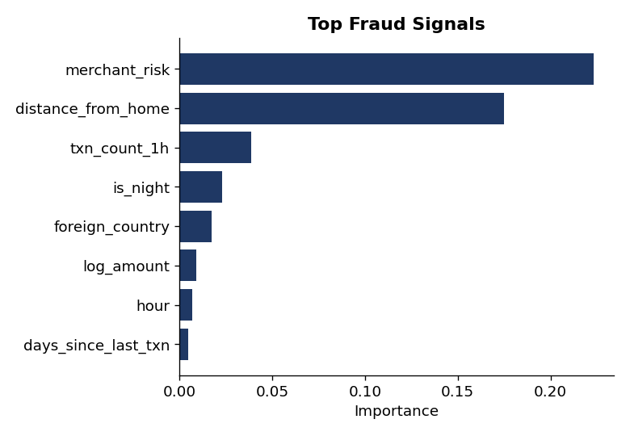

# Fraud Detection on Payment Transactions

[](https://github.com/Ehsan-Ghoreishi/fraud-detection/actions/workflows/ci.yml)


A fraud detection system for card transactions, built the way a **fraud /
risk analytics team** works: point-in-time customer features, out-of-time
evaluation with a label-delay embargo, a decision threshold set by business
cost, a benchmark against a rule engine, and a reason code on every alert.

One evaluation protocol ([`protocol.py`](src/fraud_detection/protocol.py))
runs on three data tracks:

| Track | Data | What it is for |
|---|---|---|
| **Real: ULB** | 284,807 European card transactions (Sept 2013), 492 frauds | Real-data check of the protocol |
| **Real: IEEE-CIS** | 590,540 Vesta e-commerce transactions, 3.5% fraud | Full pipeline on real data: reconstructed clients, behaviour features, attack-level metrics |
| **Simulated portfolio** | 2,500 customers, 6 months, 4 fraud typologies, drift | What real data can't show: ground truth per typology, unreported fraud |

> Built by **Seyedmohammad (Ehsan) Ghoreishi** — a data professional focused on
> risk, fraud, and financial analytics.

---

## Results at a glance

All numbers are measured on an **out-of-time** test period that played no
part in feature statistics, model selection or threshold tuning.

| | Real: IEEE-CIS | Real: ULB | Simulated portfolio |
|---|---|---|---|
| Test period | Apr–May 2018 (176k txns) | last 12 of 48 hours | May–June 2026 |
| Selected model (by CV) | gradient boosting | gradient boosting | random forest |
| **PR-AUC** (95% CI) | **0.52** (0.49–0.54) | **0.78** (0.71–0.84) | **0.65** (0.59–0.70) |
| ROC-AUC | 0.89 | 0.98 | 0.96 |
| Fraud base rate | 3.4% | 0.12% | 0.53% |
| Recall at 1% alert budget | 26% (precision 88%) | 85% | 81% |
| Recall at deployed (cost-optimal) threshold | 85% at a 26% alert rate | 83% | 83% |
| Cost vs no model | €334k vs €1.07M | €6.5k vs €18.7k | €9.7k vs €71.6k |
| Compromised accounts / attacks detected | 90% of 2,613 | n/a: no card IDs | 64% of 158 |
| vs rule engine at same workload | 54% vs 9% recall | n/a: fields missing | 87% vs 62% recall |

PR-AUC is not comparable across columns: its baseline is the fraud rate,
which differs 30-fold between the datasets.

---

## Real data

### ULB credit card data

Real transactions by European cardholders, released by the ULB Machine
Learning Group (Dal Pozzolo et al.) and fetched from OpenML
([`ulb.py`](src/fraud_detection/ulb.py)). The features are anonymised PCA
components (V1–V28) plus time and amount; there are **no card or customer
IDs**, so behaviour features and attack-level metrics can't be computed.
The protocol still can: train on the first 36 hours, test on the last 12.

| | Value |
|---|---|
| Gradient boosting test PR-AUC | **0.777** (95% CI 0.705–0.842) |
| Logistic regression (diagnostic) | 0.744 |
| Recall / precision at the deployed threshold | 83.5% / 18.0% |
| Top signals | V14, V17, V4, V12 (matching the literature) |

**An honest failure, reported as is.** The threshold is carried from CV to
the final model as an alert rate, anchored on the embargo window (see
[below](#the-decision-a-risk-analyst-owns-the-threshold)). On ULB that
window is the morning of day 2, when the fraud rate (0.075%) was a third of
the training period's. The anchor therefore set the threshold too low:
**€6.5k vs €5.1k at 0.5** or at the CV-scale threshold. Anchoring assumes
a stable fraud rate, and 48 hours with strong time-of-day effects can't
provide a representative window. On the simulated track, where the anchor
covers two full weeks, the same method has a regret of only €62.

```bash
make ulb          # downloads from OpenML, writes reports/ulb/
```

### IEEE-CIS (Vesta) — full pipeline on real data

590,540 real e-commerce transactions from Vesta, December 2017 – May 2018
([`ieee/`](src/fraud_detection/ieee)). There is no customer ID, so a client
is reconstructed as card + billing address + account start day
(transaction day − D1), the approach validated by top competition
solutions: **217,779 clients**. The same point-in-time behaviour features
as the simulated track then run on them. Training ends on 17 March, a
14-day label-delay embargo follows, and April–May (175,998 transactions)
is the out-of-time test.

| Model | CV PR-AUC (4 folds) | Test PR-AUC |
|---|---|---|
| **Gradient boosting** (selected) | 0.522 | **0.515** (95% CI 0.488–0.542) |
| Gradient boosting without our behaviour features (ablation) | 0.521 | 0.516 |
| Logistic regression | 0.359 | 0.233 |

Test ROC-AUC 0.892. CV and test agree closely, so the protocol did not
overstate performance.

**What the results show:**

- **Not just memorising known accounts.** Labels in this data propagate
  across a compromised account, so a model could score well by recognising
  accounts it saw defrauded in training. On the 104,922 test transactions
  of clients *never seen before*, PR-AUC is higher (0.559, at a fraud rate
  of 4.4%).
- **Attacks are caught early.** At the deployed threshold, 90.5% of the
  2,613 compromised accounts in the test period are flagged, 88% of them on
  their first fraudulent transaction; 7.5% of fraud value is lost before
  the first alert.
- **Beats rules at equal workload.** At the rule engine's 8,024 alerts, the
  model catches 54% of fraud and the rules 9%. The rules were written for
  the simulated portfolio, so this is a weak benchmark, not a production
  rule set.

**Two results that are not flattering, reported as they are:**

1. **Our behaviour features add nothing here** (+0.001 CV PR-AUC; 0.3% of
   permutation importance). Vesta's C and D columns already encode
   per-card counts and time since previous activity, which is what those
   features compute. On the simulated data, which lacks such columns, they
   are the strongest signals. Feature engineering has to be judged against
   what the data already contains.
2. **The cost-optimal threshold is not operable.** With €5 per review and
   every missed fraud costing its amount + €20, flagging **26% of traffic**
   (748 alerts a day) minimises cost: €334k vs €440k at 0.5 and €1.07M
   with no model, regret €9.1k vs the hindsight optimum. No team reviews
   26% of transactions, so the alert-budget view is the operational one:

| Alert budget | Alerts / day | Recall | Precision | Fraud value caught |
|---|---|---|---|---|
| 0.5% | 14 | 13.4% | 92% | 6.8% |
| 1% | 28 | 25.5% | 88% | 15.0% |
| 2% | 57 | 39.6% | 68% | 28.9% |
| 5% | 142 | 55.8% | 39% | 52.2% |

At small budgets the alerts are highly precise but catch less *value* than
transactions: the frauds the model is most sure of are smaller than the
average fraud. A team with a fixed budget would rank by expected loss
(score × amount) instead of score. Recall at the deployed threshold ranges
by product from 76% (W, the largest) to 96% (R).

**Where this stands.** The competition's winning solutions reached about
0.945 ROC-AUC on Kaggle's (later, unlabelled) test set, using hundreds of
client-level aggregates and heavily tuned LightGBM/CatBoost ensembles. This
track uses one untuned gradient boosting model, because its goal is an
honest protocol on real data, not a leaderboard score.

The data's licence forbids redistribution, so it is downloaded with the
Kaggle API after you accept the
[competition rules](https://www.kaggle.com/competitions/ieee-fraud-detection/rules)
and place an API token in `~/.kaggle/`. Only aggregate metrics and figures
are committed ([`reports/ieee/`](reports/ieee)).

```bash
pip install -e ".[ieee]"
make ieee         # downloads, trains (~15 min, ~9 GB RAM), writes reports/ieee/
```

The code is tested in CI on a fixture with the IEEE-CIS schema
([`tests/test_ieee.py`](tests/test_ieee.py)).

---

## Why this project is different

| Reality | How it is handled here |
|---|---|
| "Unusual" is relative to the customer | Behavioural features vs the customer's own history |
| Features must exist at authorisation time | Point-in-time: each row sees only *earlier* transactions — [tested](tests/test_features.py) |
| Models are used on the future | Out-of-time test set + forward-chaining CV |
| Labels arrive weeks late | Label-delay embargo before the test period and inside CV |
| Fold models score on different scales | CV scored per fold, and the threshold transferred as an alert rate |
| Model selection is noisy | Runner-ups' test scores reported as diagnostics |
| A €900 miss ≠ a €2 miss | Missed-fraud cost = amount + chargeback fee |
| A fraud team counts stopped *attacks* | Detection per attack, € lost before the first alert |
| "Better than what we have?" | Rule engine benchmark at equal alert volume |
| Analysts need a *why* | Reason codes for every alert |

---

## The evaluation protocol

```
transaction log ──► point-in-time behaviour features ──► out-of-time split
                                     train (labels known) │ embargo │ test
                                                          │ no labels│
   forward-chaining CV ─ every fold model sees ≥ 50% of the history,
   (embargo gap)          scored per fold and averaged ──► pick model
                                                          │
   cost-optimal alert rate on the 2 most recent folds ────┤
   refit on all labelled data, place threshold at that    │
   alert rate on the embargo window's scores ─────────────┤
                                                          ▼
   score test once ──► cost, regret vs hindsight, clustered CIs, attack-level
                       detection, rule benchmark, reason codes
```

Three of these steps exist because an earlier version got them wrong. The
[changelog](CHANGELOG.md) has the details:

1. **Pooled CV scores mixed score scales.** Moving one fold boundary by 188
   rows changed CV PR-AUC from 0.75 to 0.59. Folds are now scored
   separately and averaged.
2. **The first fold model trained on 7 days** and dominated the average.
   Every fold model now sees at least half of the history.
3. **A raw CV threshold doesn't transfer** to a model trained on more data
   (regret €2.5k). The alert rate does (regret €62 on the simulated track).

---

## The simulated portfolio

Real data lacks ground truth for *why* a transaction is fraud.
[`simulation.py`](src/fraud_detection/simulation.py) simulates 2,500
customers over six months (~258k transactions, 0.53% fraud). Each customer
has a spend level, preferred hours, devices (phones get replaced), online
habits and sometimes a trip abroad, so legitimate traffic overlaps heavily
with classic fraud signals. Fraud comes in four typologies; from May the mix
shifts toward account takeover and card testers raise their test amounts.
Some fraud is never reported.

| Typology | Footprint |
|---|---|
| **Card testing** | Bursts of €0.50–9 online charges from a bot device, then a gift-card / electronics cash-out |
| **Account takeover** | New device, several purchases at 3–11× the customer's usual spend |
| **Cloned card** | In-store spending far from home, often abroad |
| **Stealth** | One purchase that looks like the customer's own |



### Model selection, honestly

| Model | CV PR-AUC (per-fold mean) | Test PR-AUC |
|---|---|---|
| Logistic regression | 0.586 | 0.535 (diagnostic) |
| **Random forest** (selected) | **0.761** | **0.652** |
| Gradient boosting | 0.753 | 0.748 (diagnostic) |

Random forest wins CV by 0.008, a margin smaller than the fold-to-fold
variation (per-fold PR-AUC ranges 0.63–0.88). On the future, gradient
boosting would have been clearly better. The selection rule was not changed
after seeing this, because that would be tuning on the test set. It is
reported because model selection is noisy, and a reviewer should be able
to see how noisy.



### The decision a risk analyst owns: the threshold

A missed fraud costs its **amount plus a €20 chargeback fee**; a false alarm
costs **€5**. CV fold models are trained on less, older history than the
final model, so their scores sit on a different scale. What transfers is
the cost-optimal **alert rate** (1.15%). The deployed threshold is the score
at that rate on the final model's predictions for the embargo window:
transactions already seen on deployment day but not yet labelled.



| Threshold | Test cost |
|---|---|
| Default 0.5 | €18,705 |
| Raw CV threshold 0.20 | €10,453 |
| **Deployed 0.131 (alert-rate transfer)** | **€9,726** |
| Best possible in hindsight (0.12) | €9,664 |

The saving against 0.5 is significant (95% CI €5.2k–€13.0k). Change the
assumptions and the pipeline re-derives everything:

```bash
fraud-detection train --chargeback-fee 40 --cost-fp 12
```

### Attacks, not transactions

| Typology | Attacks stopped |
|---|---|
| Account takeover | 95.5% |
| Card testing | 100% |
| Cloned card | 100% |
| Stealth | 0% |

45% of attacks are stopped on their **first** fraudulent transaction and
9.7% of fraud value is lost before the first alert. All 29 card-testing
attacks raised an alert during the small test charges, before the
cash-out. At the rule engine's 2,118 alerts, the model catches **87%** of
fraud and the rules **62%**.



Stealth fraud is never caught: it looks like the customer's own spending.
That is a finding for the business (e.g. cardholder push notifications),
not something to tune away. May, the first month after the tactics shift,
is the weakest (PR-AUC 0.61 vs 0.71 in June).

### Every alert explains itself

Model-agnostic reason codes reset one feature group at a time to a typical
value and report the ones that drive the score
([sample](reports/sample_alerts.csv)):

| Amount | Category | Reasons | Truth |
|---|---|---|---|
| €2.18 | digital goods | device first seen in the last 24h; unusual transaction amount; risky merchant category | card testing |
| €213.41 | electronics | device first seen in the last 24h; unusual gap since the previous transaction; unusual transaction amount | account takeover |
| €149.11 | jewelry | far from home; risky merchant category; unusual transaction amount | cloned card |



---

## Run it yourself

```bash
pip install -e ".[dev]"

make all        # simulated track: data, EDA, train, evaluate, reports (~2 min)
make ulb        # real ULB track (~1 min, downloads from OpenML)
make ieee       # real IEEE-CIS track (Kaggle token required)
make test       # test suite
```

The simulated track can also be run step by step:

```bash
fraud-detection generate                        # data/transactions.csv
fraud-detection eda                             # reports/eda_overview.png
fraud-detection train                           # metrics, figures, model bundle
fraud-detection score log.csv -o scored.csv     # fraud_probability, flag, reasons
```

Everything is seeded; `make all` and `make ulb` reproduce every number above.

---

## Project structure

```
src/fraud_detection/
├── protocol.py     # the shared evaluation protocol (split, CV, threshold, test)
├── validation.py   # out-of-time split, label-delay embargo, forward-chaining CV
├── evaluation.py   # cost curve, threshold transfer, clustered bootstrap, attack metrics
├── explain.py      # reason codes, grouped permutation importance
├── ulb.py          # real track: ULB card data
├── ieee/           # real track: IEEE-CIS (data, features, models, pipeline)
├── simulation.py   # simulated portfolio (typologies, drift, label noise)
├── features.py     # point-in-time behaviour features + FraudFeatures
├── models.py · model.py · rules.py · scoring.py
├── eda.py · plots.py · cli.py · data.py · config.py
tests/              # unit + end-to-end tests, incl. look-ahead and embargo checks
notebooks/          # step-by-step walkthrough of the simulated track
reports/            # simulated track; reports/ulb/ and reports/ieee/ for real data
docs/model_card.md  # intended use, evaluation, limitations
```

See the [model card](docs/model_card.md) for limitations and the
[changelog](CHANGELOG.md) for how the project evolved.

## Tech stack

`Python` · `pandas` · `NumPy` · `scikit-learn` · `Matplotlib` · `pytest` ·
`ruff` · `GitHub Actions`

## Skills demonstrated

Fraud typologies and behavioural feature design · point-in-time feature
engineering · out-of-time and forward-chaining validation with a label-delay
embargo · threshold transfer across retrained models · attack-level
detection metrics · imbalanced classification · gradient boosting ·
cost-sensitive decisions · rule-engine benchmarking · explainability (reason
codes, grouped permutation importance) · customer-clustered bootstrap ·
working with real, anonymised payment data · tested, packaged, CI-checked
code.

## License

Code released under the [MIT License](LICENSE). The ULB and IEEE-CIS data
remain under their own terms and are downloaded, never redistributed.
