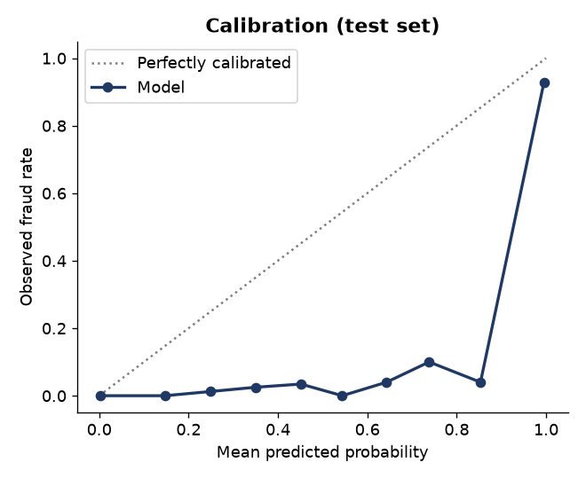

# Model Card — Card-Transaction Fraud Classifier

## Overview

| | |
|---|---|
| **Task** | Binary classification: is a card transaction fraudulent? |
| **Output** | Fraud score, a 0/1 *review* flag at a cost-tuned threshold, and reason codes |
| **Selected model** | `HistGradientBoostingClassifier` (`class_weight="balanced"`) on 27 features |
| **Alternatives evaluated** | Logistic regression, random forest |
| **Selection criterion** | Forward-chaining (4-fold) out-of-fold PR-AUC on the training period |
| **Artefact** | `models/fraud_model.joblib` — fitted pipeline, threshold, reason-code reference, package version |

## Intended use

A portfolio demonstration of how a fraud / risk analytics team builds,
evaluates and hands over a transaction-screening model. The flag routes
transactions to **human review**; it is not meant to decline customers
automatically.

**Not intended for** decisions on real customers: the model has only seen
simulated data.

## Data

Simulated with `fraud_detection.simulation` (seed 42): 2,500 customers,
1 January – 30 June 2026, 257,573 transactions, 0.53% labelled fraud.

- Customers have individual spend levels, active hours, online affinity,
  devices (25% replace their phone mid-period) and trips abroad (15%).
- Four fraud typologies: card testing, account takeover, cloned card
  (60% abroad, 40% domestic far from home) and stealth.
- **Drift**: from day 120 account takeover rises from 25% to 40% of
  episodes and card-test amounts rise from €0.5–3 to €1–9.
- **Label noise**: 3–5% of fraud (20% of stealth fraud) is unreported and
  labelled legitimate; `fraud_type` keeps the ground truth for analysis and
  is never a model input.

Simulated data is still cleaner than reality: no merchant compromise
events, no first-party fraud, no chargeback delay, and fraud typologies
are drawn from known distributions.

## Features

**Point-in-time behaviour** (`add_behavioural_features`, earlier
transactions of the same customer only — verified by a no-look-ahead test):
prior transaction count, seconds since last transaction, transactions and
spend in the previous hour / day, small (< €10) charges in the previous
hour, amount vs the customer's past median, device age, new device
(< 24h), first purchase in a merchant category.

**Transaction attributes** (`FraudFeatures`): log amount, amount vs the
category median (learned on training data), hour, night flag, channel,
foreign country, log distance from home, merchant risk score, one-hot
merchant category.

## Evaluation protocol

1. **Out-of-time split**: train 1 Jan – 30 Apr (170,775 txns), test
   1 May – 30 Jun (86,798 txns).
2. On the training period only: forward-chaining CV for each candidate →
   best out-of-fold PR-AUC → threshold minimising
   `Σ(amount + €20) over missed fraud + €5 × false alarms`.
3. Refit on the whole training period; score the test period **once**.

## Results (test period)

| Metric | Value | 95% bootstrap CI |
|---|---|---|
| PR-AUC | 0.733 | 0.695 – 0.771 |
| ROC-AUC | 0.970 | |
| Recall (transactions) | 83.2% (386 / 464) | 79.7% – 86.4% |
| Recall (fraud value) | 92.4% | |
| Precision | 39.5% | 37.5% – 41.8% |
| Alerts per day | 16 | |
| Threshold | 0.09 | |
| Cost at threshold / at 0.5 / no model | €9.3k / €12.5k / €71.6k | saving vs 0.5: €1.3k – €5.5k |
| Brier score | 0.0028 | |

**By typology** (recall): card testing 88%, account takeover 90%, cloned
card 100% (n = 46), stealth 2%.

**By month** (PR-AUC): May 0.71, June 0.76 — the first month after the
tactics shift is the weakest.

**Rule-engine benchmark**: at the rule engine's 2,118 alerts, rules catch
62% of fraud and the model 87%.

**Unreported fraud**: 8 of 24 unlabelled fraud transactions are flagged —
in production these would surface as "false positives" that are actually
fraud.

Source of truth: `reports/metrics.json`.

## Explainability

- **Per alert**: reason codes (`explain.py`). Each feature group is reset
  to a typical training value and the groups that lower the score most are
  reported in plain language. Sample: `reports/sample_alerts.csv`.
- **Global**: permutation importance on the test period
  (`reports/feature_importance.png`); device age, merchant risk, distance
  and the new-device flag lead.

## Calibration

Class weighting makes the model over-predict: mid-range scores correspond
to observed fraud rates well below the score. Ranking, the cost-tuned flag
and reason codes are unaffected, but the output is a **score, not a
probability**. Wrap the pipeline in `CalibratedClassifierCV` (and re-tune
the threshold) if calibrated probabilities are needed, e.g. for
expected-loss reporting.

## Limitations and risks

- **Stealth fraud is not detected.** Transactions that match the
  customer's own behaviour need other controls (cardholder notifications,
  dispute analytics).
- **Device dependence.** Device age is the strongest signal; device-ID
  spoofing or shared devices would weaken the model considerably.
- **Simulated data** (see above); absolute numbers will not transfer.
- **Cold start.** New customers have little history, so behaviour features
  are uninformative for their first transactions.
- **Fairness** not assessed: there are no customer demographics in the
  data. On real data, alert rates should be compared across customer
  segments and features like `foreign_country` reviewed for disparate
  impact (e.g. on migrant customers who often transact abroad).
- **Static costs.** Fixed review cost and chargeback fee; no customer
  lifetime-value effect of false declines.

## Maintenance

Monitor monthly PR-AUC and recall by typology; retrain when they fall or
when the typology mix changes. Re-derive the threshold whenever cost
assumptions change:
`fraud-detection train --chargeback-fee <€> --cost-fp <€>`.
